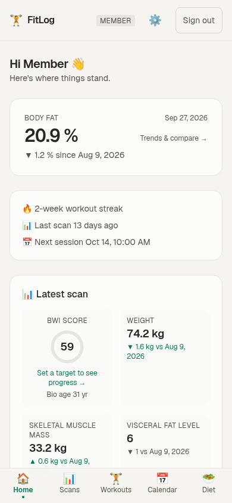
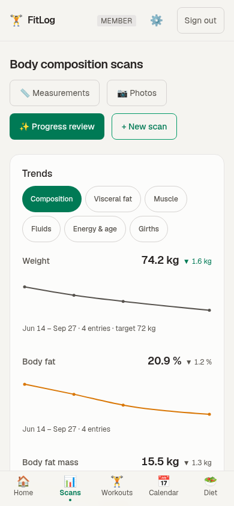
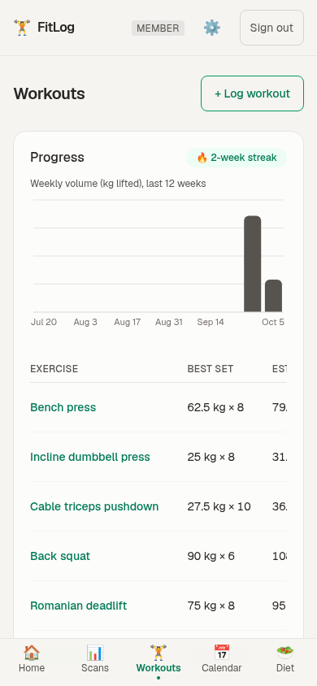
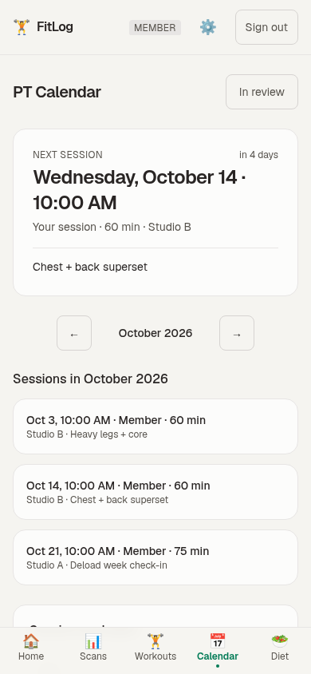
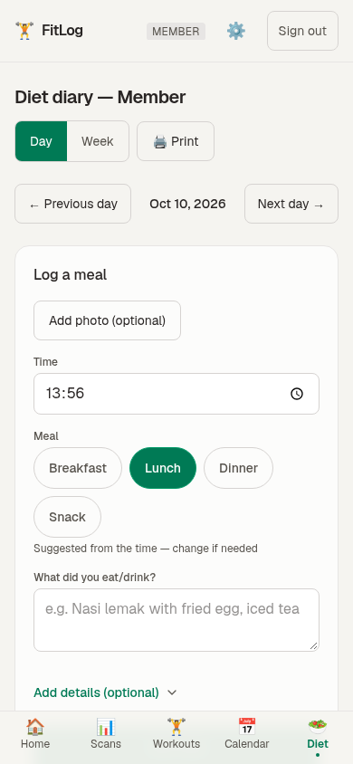

# FitLog

[](https://github.com/ujai/FitLog/actions/workflows/ci.yml)
[](LICENSE)

A self-hosted health tracker for a small household and their personal trainer:

- **Body composition scans** (Evolt 360) — upload a screenshot, AI reads the numbers, compare any two scans side by side, trend charts, AI review with actionable pointers
- **Workout log** — trainer or member logs exercises, sets, reps, weights; reusable templates a trainer can share with members, coach comments on a workout, and a per-exercise history page with estimated 1RM
- **PT calendar** — shared month view, upcoming-session cards, weekly-repeating sessions, prepaid session packages, personal ICS feed for Google/Apple Calendar
- **Diet diary** — meal log with optional photo + macros, day/week views against optional daily food targets, print-friendly weekly handout for the dietician
- **Your data** — CSV download per domain (scans, measurements, workouts, meals) and a CSV import for past history; nightly `pg_dump` backups

Three roles, enforced server-side:

| Role    | Sees                              | Can do                                       |
| ------- | --------------------------------- | -------------------------------------------- |
| member  | own data only                     | log own scans/workouts/meals                 |
| trainer | all members' data                 | log workouts/sessions, schedule PT sessions  |
| admin   | everything + `/users` management  | create/remove accounts                       |

## Screenshots

Phone-sized, with made-up demo data.

<p>
  
  
  
  
  
</p>

## Stack

- [Next.js 16](https://nextjs.org) (App Router, Server Actions) + TypeScript + Tailwind CSS 4
- [Better Auth](https://better-auth.com) v1.7 — Google OAuth sign-in with a server-side email allowlist, DB-backed sessions, rate limiting, admin plugin; public sign-up and password login disabled
- [Drizzle ORM](https://orm.drizzle.team) + PostgreSQL (images stored as `bytea`, so `pg_dump` carries everything)
- [AI SDK](https://ai-sdk.dev) + Google Gemini (`gemini-3.6-flash`) for screenshot extraction and progress reviews — the free API tier is plenty for a few users
- Recharts for trends; PWA (installable to home screen)

## Local development

Prerequisites: Node ≥ 20, pnpm, Docker.

```bash
pnpm install
cp .env.example .env.local        # then edit values
docker compose up -d db           # local Postgres on 127.0.0.1:5432

pnpm db:migrate                   # apply migrations
pnpm db:seed                      # create admin/member/trainer accounts (sign-in is Google)

pnpm dev                          # http://localhost:3457
```

Set in `.env.local`:

| Variable             | Purpose                                                                                          |
| -------------------- | ------------------------------------------------------------------------------------------------ |
| `DATABASE_URL`       | Postgres connection string                                                                       |
| `BETTER_AUTH_SECRET` | Cookie/token secret — `openssl rand -base64 32`                                                  |
| `APP_URL`            | Public origin, e.g. `http://localhost:3000`                                                      |
| `GOOGLE_CLIENT_ID`   | Google OAuth client ID (see below)                                                               |
| `GOOGLE_CLIENT_SECRET` | Google OAuth client secret                                                                     |
| `ALLOWED_EMAILS`     | Exact whitelist of emails allowed to sign in, comma-separated                                    |
| `APP_TIMEZONE` / `NEXT_PUBLIC_APP_TIMEZONE` | Your IANA zone — set **both** to the same value, or dates are interpreted and rendered in the default `Asia/Kuala_Lumpur` |
| `GEMINI_API_KEY`     | Optional. Free key: https://aistudio.google.com/apikey — enables screenshot reading + AI reviews  |

### Google sign-in (required — it's the only login method)

There are no passwords and no public sign-up; access is a server-side allowlist. Set up a Google OAuth client once:

1. In the [Google Cloud Console](https://console.cloud.google.com), create a project
2. APIs & Services → OAuth consent screen → **External**, then add every person who may sign in as a **test user**
3. APIs & Services → Credentials → Create credentials → **OAuth client ID** → Web application
4. Authorized JavaScript origins: `APP_URL` — Authorized redirect URI: `APP_URL/api/auth/callback/google`
5. Copy the client ID/secret into `.env.local`, and list the same emails in `ALLOWED_EMAILS`

Seed each person with the email they actually use for Google (see the `SEED_*` variables in `.env.example`): the first sign-in links the Google identity to the seeded account (email match), keeping roles and data intact. Only allowlisted emails ever get in — remove one, and its next sign-in is refused.

## Self-hosting on a home server (systemd)

The app runs nicely as a systemd **user service**: it survives reboots (with linger enabled) and restarts on crash. Postgres comes up on its own via `restart: unless-stopped` in `docker-compose.yml`, and the service waits for it to be healthy before starting Next.js. Unit templates are in `deploy/systemd/` — adjust the clone paths inside to match your machine.

```bash
pnpm build                                  # the service serves the build output
cp deploy/systemd/* ~/.config/systemd/user/ # then edit the clone paths inside the units
systemctl --user daemon-reload
systemctl --user enable --now health-tracker health-tracker-backup.timer
loginctl enable-linger $USER                # keep running after logout

systemctl --user restart health-tracker     # after pulling + pnpm build, to serve the new code
journalctl --user -u health-tracker -f      # logs
systemctl --user stop health-tracker        # before running pnpm dev (port 3457 conflict)
```

LAN access: `http://<machine-ip>:3457` — the machine's IP must be in `TRUSTED_ORIGINS`, or sign-in gets a CSRF 403.

### Daily backups

The backup timer runs `scripts/backup-db.sh` every night at 03:30 (or at the next boot if the machine was off). It writes a `pg_dump` custom-format file to `~/backups/health-tracker/` and keeps the newest 14. Images are in the database, so that one file is everything.

```bash
pnpm db:backup                                         # back up now
systemctl --user list-timers health-tracker-backup     # next run
journalctl --user -u health-tracker-backup             # backup log
# restore (replaces the current data):
docker compose exec -T db pg_restore --clean --if-exists --no-owner -U health -d health < ~/backups/health-tracker/<file>.dump
```

`BACKUP_DIR` and `BACKUP_KEEP` override the location and count. The backups sit on the same disk as the database, so copy them somewhere else now and then.

## Free-tier deployment (Vercel + Neon)

1. **Database** — create a project at [neon.tech](https://neon.tech) (free), copy the pooled connection string. Neon sleeps when idle and wakes on request — nothing breaks, the first request is just slower.
2. **App** — import this repo into [Vercel](https://vercel.com), add env vars:
   - `DATABASE_URL` = Neon connection string
   - `BETTER_AUTH_SECRET` = `openssl rand -base64 32`
   - `APP_URL` = `https://<your-app>.vercel.app`
   - `GOOGLE_CLIENT_ID` / `GOOGLE_CLIENT_SECRET` — see "Google sign-in" above (redirect URI `APP_URL/api/auth/callback/google`)
   - `ALLOWED_EMAILS` = the emails allowed to sign in
   - `APP_TIMEZONE` + `NEXT_PUBLIC_APP_TIMEZONE` = your IANA zone
   - `GEMINI_API_KEY` (optional)
3. Migrate + seed once from your machine: point `.env.local`'s `DATABASE_URL` at Neon, run `pnpm db:migrate && pnpm db:seed`.
4. Everyone signs in with their Google account on `/login` — only whitelisted emails pass.

For a few users, free tiers are effectively unlimited (Neon: 0.5 GB storage / 100 CU-hours per month; Vercel Hobby includes serverless + HTTPS).

## Future VPS migration (no rewrite)

The same codebase runs anywhere Node runs:

- `docker compose up -d db` gives you Postgres; run `pnpm build && pnpm start` behind Caddy (`your.domain { reverse_proxy localhost:3000 }`) for automatic HTTPS
- Or containerize the app itself and keep using Neon, then switch `DATABASE_URL` later
- Migrate data with `pg_dump` / `pg_restore`

## Security notes

- Sign-in is Google OAuth only — no passwords are stored or accepted; every sign-in, sign-up and account link is checked against the server-side `ALLOWED_EMAILS` whitelist; login rate-limited
- Every page, server action and route handler checks auth + role server-side; images are served through authenticated endpoints
- Strict security headers + CSP (see `next.config.ts`), HSTS, no framing, no indexing (`robots: noindex`)
- Per-user ICS tokens are unguessable and regenerable from the Account page
- Health data is sensitive: keep `BETTER_AUTH_SECRET` and DB credentials out of git, enable Neon's scheduled backups (or run the `pg_dump` timer — see "Daily backups"), rotate the ICS token if a link leaks

## Project layout

```
src/
  app/
    (app)/            # authenticated app: dashboard, scans, workouts, calendar, diet, users, account
    login/            # sign-in page
    api/              # auth handler, scan/meal images (authz-checked), ICS feed
  components/         # client components (forms, charts, calendar bits)
  db/                 # drizzle schema, client, seed script
  lib/                # auth config, session helpers, Gemini calls, validation, formatting
  server/             # server actions per domain (scans, workouts, calendar, diet, users)
  proxy.ts            # optimistic auth redirect (real authz is server-side)
drizzle/              # migration SQL
deploy/systemd/       # self-hosting unit templates (app service + nightly backup timer)
```

## Contributing

PRs welcome — see [CONTRIBUTING.md](CONTRIBUTING.md). `AGENTS.md` (stack gotchas and conventions) and `DESIGN.md` (the design system) are normative, not decoration.

## License

[MIT](LICENSE) — self-host it, fork it, adapt it for your household.
